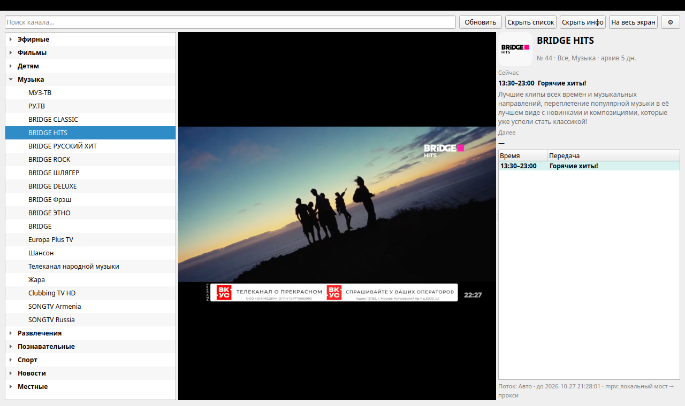
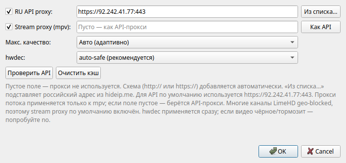
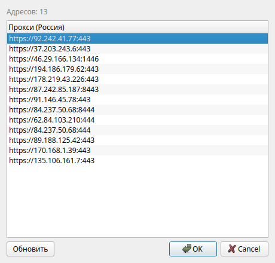

# LimeHD Эфир

Настольное приложение для просмотра телеканалов **limehd.tv** на компьютере.
Список каналов, поиск, программа передач и встроенный плеер — всё в одном окне.



## Возможности

- 📺 список телеканалов с группами и поиском;
- 🖼️ логотипы каналов;
- 📅 программа передач: что идёт сейчас и что будет дальше;
- 🔍 поиск по названию канала;
- 🎚️ выбор качества: авто, 1080p, 720p, 480p, 360p, 240p;
- 🖥️ полноэкранный режим;
- 🌐 российский прокси для каналов, которые недоступны напрямую;
- 💾 кэш списка каналов — приложение быстро открывается при следующем запуске.

## Установка и запуск

Для запуска нужен Python 3.9 или новее.

### Linux (Debian/Ubuntu)

```bash
sudo apt install mpv libmpv2 python3-venv
python3 -m venv .venv
. .venv/bin/activate
python3 -m pip install -r requirements.txt
python3 limehd_gui.py
```

### Windows

1. Установите Python 3.9 или новее.
2. В папке с программой откройте командную строку и выполните:

```bat
python -m venv .venv
.venv\Scripts\activate
python -m pip install -r requirements.txt
python limehd_gui.py
```

Для встроенного плеера на Windows нужен файл `mpv-2.dll`: положите его
рядом с `limehd_gui.py` или добавьте в `PATH`.

## Настройки

Нажмите на шестерёнку **⚙** в правом верхнем углу.



- **Макс. качество** — ограничение качества видео.
- **hwdec** — аппаратное ускорение. Обычно оставьте `auto-safe`.
  Если видео чёрное или сильно тормозит — выберите `no`.
- **RU API proxy** — российский прокси для загрузки списка каналов.
- **Stream proxy (mpv)** — отдельный прокси для видео. Если поле пустое,
  используется адрес из API-прокси.
- **Из списка…** — выбрать российский прокси из готового списка.
- **Как API** — скопировать адрес API-прокси в поле для видео.
- **Проверить API** — проверить, работает ли прокси.
- **Очистить кэш** — загрузить список каналов заново.



## Если каналы не открываются

- **Пустой список каналов** — проверьте интернет и прокси, затем нажмите
  **«Обновить»**.
- **«Телеканал недоступен в вашем регионе»** — включите **Stream proxy**
  в настройках или выберите другой российский прокси.
- **Чёрный экран или сильные тормоза** — в настройках поставьте
  `hwdec: no`.
- **Некоторые каналы не работают** — часть каналов закрыта по региону
  или защищена DRM. Попробуйте другой канал или другой прокси.
- **Приложение не запускается** — проверьте, что установлены `mpv`,
  `libmpv` и зависимости из `requirements.txt`.

Приложение не обходит платную подписку и не предназначено для
распространения чужого контента.

## Горячие клавиши

| Клавиши | Действие |
|---|---|
| `Ctrl+F` | поиск канала |
| `Ctrl+R` | обновить список |
| `Ctrl+L` | показать/скрыть список |
| `Ctrl+I` | показать/скрыть панель информации |
| `Ctrl+,` | настройки |
| `F11` | полный экран |
| `F` (в окне видео) | полный экран |
| `Esc` | выйти из полного экрана |
| `Space` / `M` (в окне видео) | пауза / mute |
| `↑` / `↓` (в окне видео) | предыдущий / следующий канал |
| `←` / `→`, колесо (в окне видео) | громкость |

## 🔨 Как создавался проект

Проект создан с помощью **вайб-кодинга** (Vibe Coding): интерфейс, плеер
и настройки разрабатывались в совместной работе с ИИ-агентом.

## 💸 Поддержать проект

Если проект оказался полезным:

- **USDT (TRC-20):** `TBGQZUwquq2yLPZzwYUpgYYPeLMcbJSLoz`
- **BTC (Bitcoin Mainnet):** `1KbXEYvGY4oURR7HCBvCMfhbyEcU3jM8mL`
- 🌐 [WebMoney / ETH / LTC / ...](https://pay.web.money/d/fwxz)
- 💳 [MIR Cards / ЮMoney](https://yoomoney.ru/to/410014392099996)
